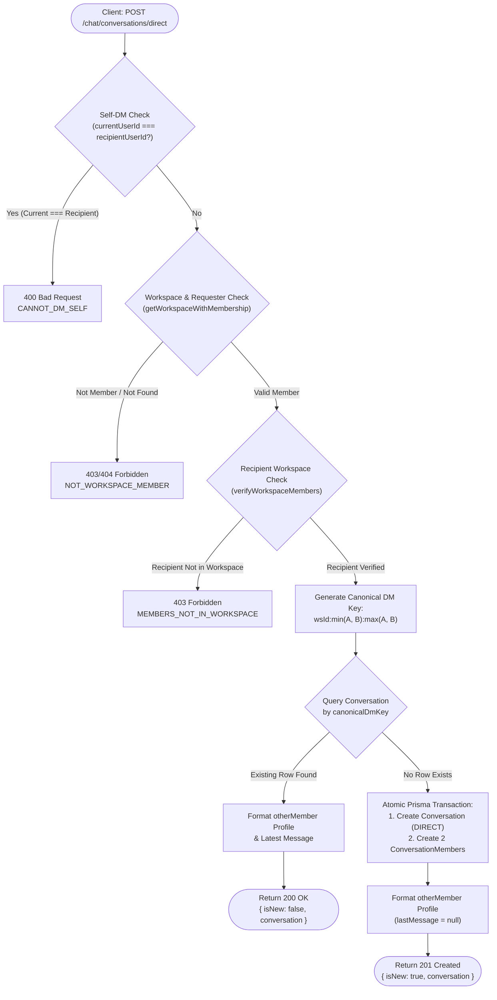
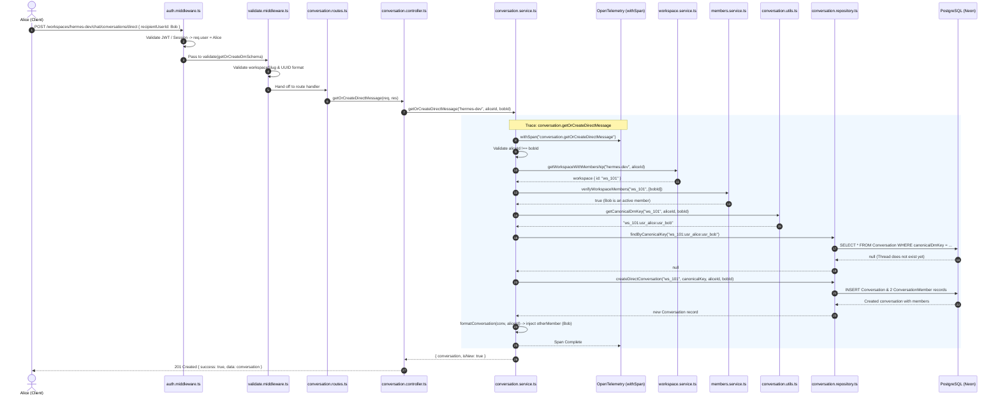
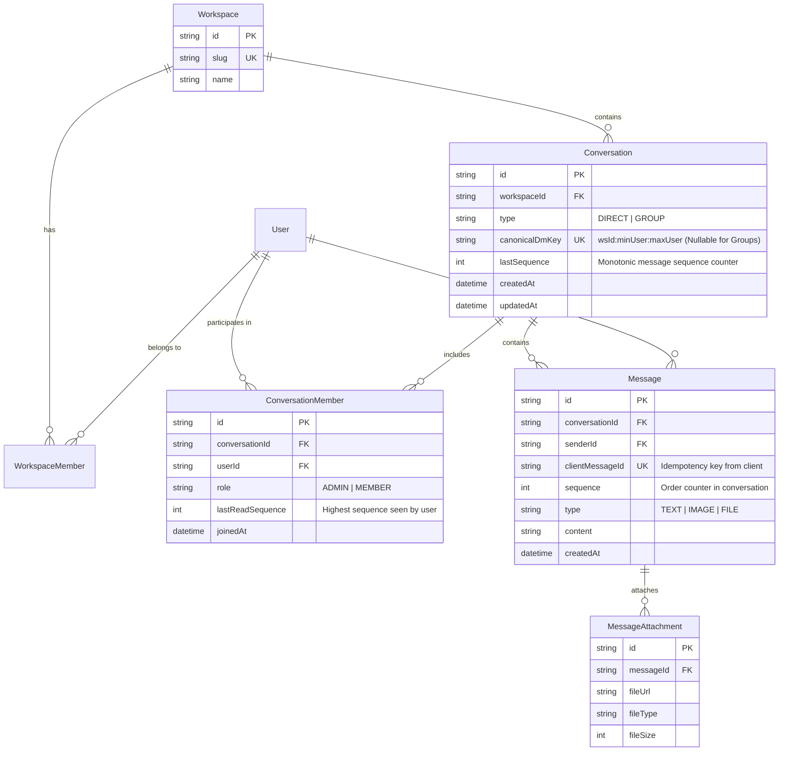
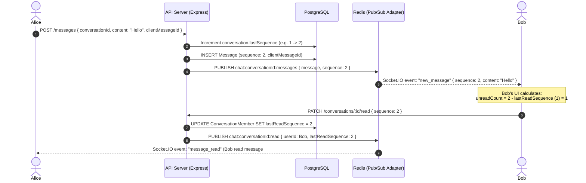
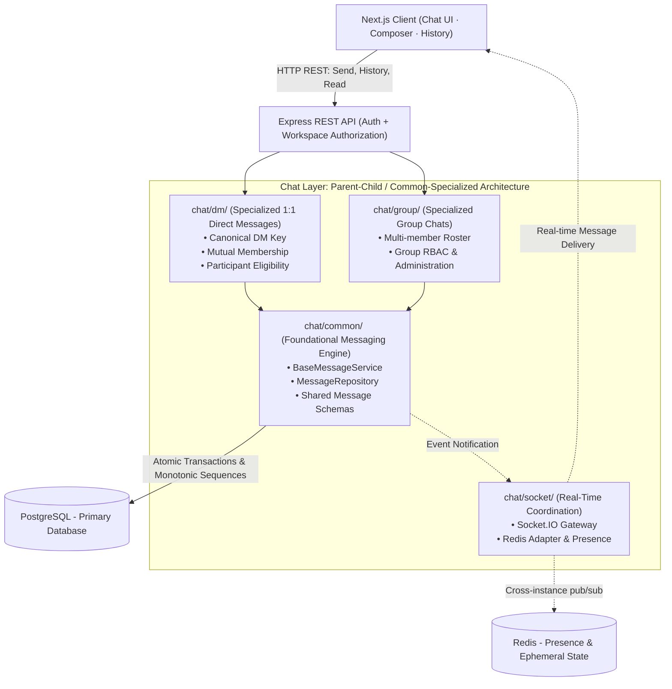
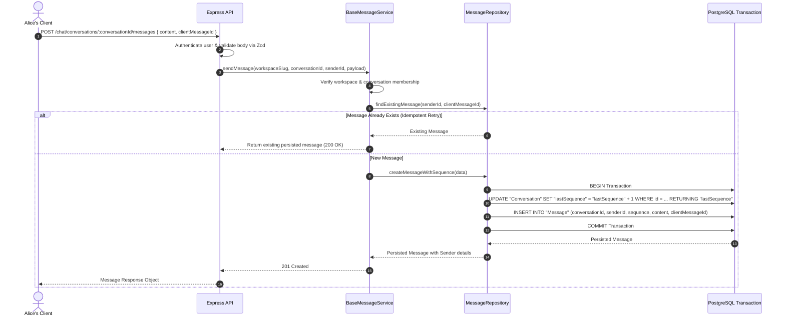

# 👤 Direct Messaging (DM) Implementation & Architecture Guide

**Owner:** Harshit (DM & Core Backend Lead)  
**Status:** Completed & Refactored (Weekend 1)  
**Parent Plan:** [Chat Layer Implementation Plan](./chat-layer-plan.md)  
**Database Schema Reference:** [Unified Chat Database Architecture](../database/unified-chat-schema.md)  
**Source Code Root:** `apps/api/src/modules/chat/conversation/`

---

## 1. High-Level Architecture & Core Concepts

The 1:1 Direct Messaging engine allows any two workspace members to communicate privately without creating duplicate threads. To maintain strict data integrity and prevent race conditions across distributed instances, the design is founded on three core pillars:

1. **Canonical DM Key (Zero-Duplicate Invariant):**
   A deterministic string key derived by lexicographically sorting the two user IDs:
   $$\text{canonicalDmKey} = \text{workspaceId} + ":" + \min(\text{userA}, \text{userB}) + ":" + \max(\text{userA}, \text{userB})$$
   Whether Alice starts a chat with Bob, or Bob starts a chat with Alice simultaneously, both map to the exact same unique constraint in PostgreSQL (`@unique([canonicalDmKey])`).

2. **Monotonic Conversation Sequence (`lastSequence`):**
   Instead of relying on fragile client timestamps, each conversation thread tracks a strictly increasing monotonic integer counter (`lastSequence`). Every message inserted into the conversation increments this sequence atomically.
   $$\text{unreadCount} = \text{conversation.lastSequence} - \text{member.lastReadSequence}$$

3. **Workspace Boundary & Mutual Verification:**
   DMs cannot cross workspace boundaries. Both the requester and the recipient are validated against the workspace membership before any database query or thread creation occurs.

---

## 2. Architecture & Flow Diagrams

### Diagram 1: Canonical DM Resolution Flowchart
This flowchart illustrates the complete decision tree when a client requests or creates a 1:1 direct message thread:



---

### Diagram 2: End-to-End Request/Response Sequence
Detailed interaction across Express middlewares, Zod validation, Service layer, OpenTelemetry tracing, and the Database:



---

### Diagram 3: Entity-Relationship Diagram (DM Data Model)
The relational model connecting Workspaces, Users, Conversations, Members, and Messages:



---

### Diagram 4: Real-Time Messaging & Read Receipt Lifecycle
When Alice sends a message to Bob inside this conversation and Bob marks it as read:



---

## 3. Directory Structure & File Breakdown

The entire 1:1 DM engine resides in `apps/api/src/modules/chat/conversation/`:

```text
apps/api/src/modules/chat/conversation/
├── conversation.utils.ts       # Canonical DM key generation math
├── conversation.schema.ts      # Zod validation schemas for requests
├── conversation.repository.ts  # Prisma queries for Conversation & Member
├── conversation.service.ts     # Business logic, authorization, & OTel withSpan
├── conversation.controller.ts  # Express request/response handlers
└── conversation.routes.ts      # Express route definitions
```

---

### 3.1 `conversation.utils.ts`

#### Function: `getCanonicalDmKey`
- **Signature:** `getCanonicalDmKey(workspaceId: string, userAId: string, userBId: string): string`
- **Purpose:** Sorts the two UUIDs alphabetically and produces a deterministic unique key.
- **Implementation:**
  ```typescript
  export function getCanonicalDmKey(
    workspaceId: string,
    userAId: string,
    userBId: string,
  ): string {
    const [smallerId, greaterId] = [userAId, userBId].sort();
    return `${workspaceId}:${smallerId}:${greaterId}`;
  }
  ```
- **Example:**
  - `userA` = `"usr_zebra"`, `userB` = `"usr_apple"`, `workspaceId` = `"ws_1"`
  - Output: `"ws_1:usr_apple:usr_zebra"`
  - Guarantee: Calling `getCanonicalDmKey("ws_1", "usr_zebra", "usr_apple")` produces the exact same string.

---

### 3.2 `conversation.schema.ts`

Defines strict runtime schemas validated by Zod before reaching controllers:

1. **`getOrCreateDmSchema`:**
   - Validates `params.workspaceSlug` (non-empty string).
   - Validates `body.recipientUserId` (must be a valid UUID).
2. **`listConversationsSchema`:**
   - Validates `params.workspaceSlug`.
   - Validates optional `query.type` (`"DIRECT"` or `"GROUP"`).
3. **`getConversationByIdSchema`:**
   - Validates `params.workspaceSlug`.
   - Validates `params.conversationId` (must be a valid UUID).

---

### 3.3 `conversation.repository.ts`

Encapsulates all direct database access using Prisma Client:

| Method | Parameters | Description |
| :--- | :--- | :--- |
| `findByCanonicalKey` | `canonicalDmKey: string` | Retrieves a conversation by its unique canonical key. Includes members with sanitized user profiles (`id`, `name`, `email`, `imageUrl`) and the latest message snippet (`take: 1, orderBy: { sequence: "desc" }`). |
| `createDirectConversation` | `workspaceId, canonicalDmKey, currentUserId, recipientUserId` | Executes an atomic creation inserting 1 `Conversation` row (`type: DIRECT`) and 2 `ConversationMember` rows (`role: "MEMBER"`). |
| `findUserConversations` | `workspaceId, userId, type?` | Queries all conversations in the workspace where the user is an active member (`members: { some: { userId } }`). Orders by `updatedAt DESC`. |
| `findById` | `conversationId, workspaceId` | Queries a specific conversation row scoped to the given `workspaceId` with members eagerly loaded. |

---

### 3.4 `conversation.service.ts`

Handles core business rules, workspace validation, telemetry spans, and response formatting:

#### Method: `getOrCreateDirectMessage(workspaceSlug, currentUserId, recipientUserId)`
1. **Self-DM Guard:** Checks `currentUserId === recipientUserId`. If so, throws `AppError(400, "CANNOT_DM_SELF")`.
2. **Workspace & Requester Verification:** Calls `getWorkspaceWithMembership(workspaceSlug, currentUserId)` from `apps/api/src/modules/workspace/workspace.service.ts`. Ensures the workspace exists and the caller is an active member.
3. **Recipient Verification:** Calls `verifyWorkspaceMembers(workspace.id, [recipientUserId])` from `apps/api/src/modules/members/members.service.ts`. If the recipient does not belong to the workspace, throws `AppError(403, "MEMBERS_NOT_IN_WORKSPACE")`.
4. **Canonical Key Lookup:** Computes `canonicalDmKey` via `getCanonicalDmKey`.
5. **Idempotent Return / Atomic Create:**
   - If existing conversation is found: returns `{ conversation: format(existing), isNew: false }`.
   - If not found: creates new conversation via repository, returning `{ conversation: format(created), isNew: true }`.
6. **Telemetry:** Entire operation wrapped in `withSpan("conversation.getOrCreateDirectMessage", ...)`.

#### Method: `listUserConversations(workspaceSlug, currentUserId, type?)`
- Verifies workspace membership.
- Fetches all user threads in the workspace.
- Transforms each conversation so that `otherMember` profile is hoisted to top level for 1:1 DMs.
- Wrapped in `withSpan("conversation.listUserConversations", ...)`.

#### Method: `getConversationById(workspaceSlug, currentUserId, conversationId)`
- Verifies workspace membership.
- Retrieves conversation from repository.
- Checks `conversation.members.some(m => m.userId === currentUserId)`. If false, throws `AppError(403, "NOT_CONVERSATION_MEMBER")`.
- Wrapped in `withSpan("conversation.getConversationById", ...)`.

#### Helper: `formatConversation(conversation, currentUserId)`
Flattens the relational Prisma payload for the frontend:
- Dynamically finds the other participant: `conversation.members.find(m => m.userId !== currentUserId)?.user`.
- Extracts `otherMember`: `{ id, name, email, imageUrl }`.
- Extracts `lastMessage`: latest message snippet or `null`.

---

### 3.5 `conversation.controller.ts`

Express controllers mapping HTTP requests to service calls:

- **`getOrCreateDirectMessage`**:
  - Extracts `req.user.id` from the authenticated JWT session.
  - Returns `201 Created` when `isNew === true`.
  - Returns `200 OK` when `isNew === false`.
- **`listConversations`**:
  - Extracts `req.query.type` (`DIRECT` or `GROUP`).
  - Returns `200 OK` with array of conversations.
- **`getConversationById`**:
  - Extracts `req.params.conversationId`.
  - Returns `200 OK` with conversation details.

---

### 3.6 `conversation.routes.ts`

Mounted in the workspace router at `/:workspaceSlug/chat/conversations` using `Router({ mergeParams: true })`:

```typescript
const router = Router({ mergeParams: true });

router.post("/direct", validate(getOrCreateDmSchema), asyncHandler(conversationController.getOrCreateDirectMessage));
router.get("/", validate(listConversationsSchema), asyncHandler(conversationController.listConversations));
router.get("/:conversationId", validate(getConversationByIdSchema), asyncHandler(conversationController.getConversationById));
```

---

## 4. API Endpoints Reference

All endpoints require authentication (`Authorization: Bearer <token>` or session cookie).

### 4.1 Create or Fetch 1:1 Direct Message
* **Path:** `POST /api/v1/workspaces/:workspaceSlug/chat/conversations/direct`
* **Request Headers:**
  ```http
  Authorization: Bearer <jwt_access_token>
  Content-Type: application/json
  ```
* **Request Body:**
  ```json
  {
    "recipientUserId": "b4a8e291-7681-4209-9fc4-9351e39a3821"
  }
  ```
* **Response Statuses:**
  - `201 Created` — First time Alice and Bob initiate a chat.
  - `200 OK` — Chat already exists between Alice and Bob.
* **Success Response Body:**
  ```json
  {
    "success": true,
    "data": {
      "id": "c1f73b09-0824-42f2-89b5-927161b96d92",
      "workspaceId": "d3b07384-d113-4f0e-b7df-9856a9e1e231",
      "type": "DIRECT",
      "title": null,
      "description": null,
      "iconUrl": null,
      "canonicalDmKey": "d3b07384:a1b2c3d4:b4a8e291",
      "lastSequence": 0,
      "createdAt": "2026-11-10T04:15:00.000Z",
      "updatedAt": "2026-11-10T04:15:00.000Z",
      "members": [
        {
          "id": "m_1",
          "userId": "a1b2c3d4-0000-0000-0000-000000000001",
          "role": "MEMBER",
          "lastReadSequence": 0,
          "user": {
            "id": "a1b2c3d4-0000-0000-0000-000000000001",
            "name": "Alice Johnson",
            "email": "alice@example.com",
            "imageUrl": "https://lh3.googleusercontent.com/..."
          }
        },
        {
          "id": "m_2",
          "userId": "b4a8e291-7681-4209-9fc4-9351e39a3821",
          "role": "MEMBER",
          "lastReadSequence": 0,
          "user": {
            "id": "b4a8e291-7681-4209-9fc4-9351e39a3821",
            "name": "Bob Smith",
            "email": "bob@example.com",
            "imageUrl": null
          }
        }
      ],
      "otherMember": {
        "id": "b4a8e291-7681-4209-9fc4-9351e39a3821",
        "name": "Bob Smith",
        "email": "bob@example.com",
        "imageUrl": null
      },
      "lastMessage": null
    },
    "error": null
  }
  ```

---

### 4.2 List Conversations for Sidebar / Inbox
* **Path:** `GET /api/v1/workspaces/:workspaceSlug/chat/conversations`
* **Query Parameters:**
  - `type` (optional): Filter by conversation type (`DIRECT` or `GROUP`).
* **Example:** `GET /api/v1/workspaces/hermes-dev/chat/conversations?type=DIRECT`
* **Success Response (`200 OK`):**
  ```json
  {
    "success": true,
    "data": [
      {
        "id": "c1f73b09-0824-42f2-89b5-927161b96d92",
        "workspaceId": "d3b07384-d113-4f0e-b7df-9856a9e1e231",
        "type": "DIRECT",
        "canonicalDmKey": "d3b07384:a1b2c3d4:b4a8e291",
        "lastSequence": 42,
        "otherMember": {
          "id": "b4a8e291-7681-4209-9fc4-9351e39a3821",
          "name": "Bob Smith",
          "email": "bob@example.com",
          "imageUrl": null
        },
        "lastMessage": {
          "id": "msg_982",
          "content": "Hey Harshit, PR is ready for review!",
          "sequence": 42,
          "createdAt": "2026-11-10T04:20:00.000Z",
          "senderId": "b4a8e291-7681-4209-9fc4-9351e39a3821",
          "type": "TEXT"
        }
      }
    ],
    "error": null
  }
  ```

---

### 4.3 Fetch Conversation by ID
* **Path:** `GET /api/v1/workspaces/:workspaceSlug/chat/conversations/:conversationId`
* **Security:** Requester must be a member of the conversation.
* **Success Response (`200 OK`):** Returns the full conversation object with member details and latest message.

---

### 4.4 Error Status Codes & Handlers

| HTTP Status | Error Code | Root Cause |
| :--- | :--- | :--- |
| `400 Bad Request` | `CANNOT_DM_SELF` | `recipientUserId` matches the authenticated `currentUserId`. |
| `400 Bad Request` | `VALIDATION_ERROR` | `recipientUserId` is not a valid UUID format, or `workspaceSlug` is missing. |
| `403 Forbidden` | `NOT_WORKSPACE_MEMBER` | Authenticated user is not an active member of the specified workspace. |
| `403 Forbidden` | `MEMBERS_NOT_IN_WORKSPACE` | The recipient user is not a member of this workspace. |
| `403 Forbidden` | `NOT_CONVERSATION_MEMBER` | Attempting to fetch a conversation by ID that the user is not part of. |
| `404 Not Found` | `WORKSPACE_NOT_FOUND` | No workspace matching `:workspaceSlug` exists. |
| `404 Not Found` | `CONVERSATION_NOT_FOUND` | No conversation matching `:conversationId` exists in this workspace. |

---

## 5. Tracing & OpenTelemetry Integration

All service methods are wrapped with `withSpan(...)` from `apps/api/src/observability/telemetry.ts`:

```typescript
return withSpan("conversation.getOrCreateDirectMessage", async () => {
  // Logic executes inside child span...
});
```

### Trace Span Hierarchy in SigNoz:
```text
HTTP POST /api/v1/workspaces/:slug/chat/conversations/direct (Express Span)
└── conversation.getOrCreateDirectMessage (Custom Business Span)
    ├── workspace.getWorkspaceWithMembership (Service Span)
    │   └── prisma.workspace.findUnique (DB Span)
    ├── members.verifyWorkspaceMembers (Service Span)
    │   └── prisma.workspaceMember.count (DB Span)
    ├── prisma.conversation.findUnique (DB Span - Canonical Key)
    └── prisma.conversation.create (DB Span - Atomic Transaction)
```
- **Error Propagation:** If an `AppError` is thrown, `withSpan` automatically records the exception on the span and sets span status to `ERROR` with the message.
- **Latency Optimization:** Canonical DM key lookups execute in `< 3ms` thanks to the PostgreSQL unique index.

---

## 6. Frontend Integration Guidelines (`apps/web`)

### 1. Initiating a DM from a User Profile / Member List:
```typescript
import { api } from "@/lib/api-client";

export async function openDirectMessage(workspaceSlug: string, recipientUserId: string) {
  const response = await api.post(
    `/workspaces/${workspaceSlug}/chat/conversations/direct`,
    { recipientUserId }
  );
  
  const conversation = response.data.data;
  // Navigate to conversation thread
  router.push(`/workspaces/${workspaceSlug}/chat/${conversation.id}`);
}
```

### 2. Computing the Unread Badge:
```typescript
export function getUnreadCount(conversation: Conversation, currentUserId: string): number {
  const currentMember = conversation.members.find(m => m.userId === currentUserId);
  if (!currentMember) return 0;
  
  const diff = conversation.lastSequence - currentMember.lastReadSequence;
  return Math.max(0, diff);
}
```

### 3. Rendering Sidebar List:
```tsx
export function DmSidebarItem({ conversation }: { conversation: FormattedConversation }) {
  const { otherMember, lastMessage } = conversation;

  return (
    <div className="flex items-center gap-3 p-2 hover:bg-muted/50 rounded-lg cursor-pointer">
      <Avatar src={otherMember?.imageUrl} fallback={otherMember?.name?.[0]} />
      <div className="flex-1 min-w-0">
        <p className="font-medium text-sm truncate">{otherMember?.name}</p>
        <p className="text-xs text-muted-foreground truncate">
          {lastMessage?.content || "No messages yet"}
        </p>
      </div>
    </div>
  );
}
```

---

## 7. Message Backend Module: System Design & HLD

### 7.1 Architectural Overview & Core Principles

The Message Backend Module is responsible for reliable message processing, history retrieval, message sequencing, and read tracking across conversations in Hermes.



> **Golden Architectural Rule:**  
> **PostgreSQL owns the truth about messages.** Redis and Socket.IO coordinate and deliver messages in real time. If Redis or Socket.IO are temporarily unavailable or restarted, persisted messages and sequence progress remain completely safe and durable in PostgreSQL.

---

### 7.2 Parent-Child Separation of Responsibilities

To avoid code duplication across 1:1 Direct Messages, Group Chats, and Channels, Hermes implements a **common-specialized modular architecture**:

- **`chat/common/` (Foundational Messaging Engine):**
  - Implements functionality common to *every* conversation type: message creation, atomic sequence assignment, idempotency checks, cursor-based pagination, and monotonic read sequence updates.
  - Implemented once so future modules (Group Chats, Channels) reuse the exact same reliable messaging engine.
- **`chat/dm/` (Specialized 1:1 DM):**
  - Manages DM-specific business logic: deterministic canonical DM key generation (`wsId:minUser:maxUser`), mutual workspace membership verification, self-DM prevention, and 1:1 participant eligibility checks.
- **`chat/group/` (Specialized Group):**
  - Manages multi-member roster creation, role permissions (owner/admin/member), and group metadata.
- **`chat/socket/` (Real-Time Infrastructure):**
  - Transport-independent event dispatching, room coordination, and presence synchronization.

> **Principle:** Implement common functionality once in `chat/common/`, specialize only where the business rules differ in `chat/dm/` and `chat/group/`.

---

### 7.3 Core Responsibilities & Detailed Workflows

| Responsibility | What it does |
| :--- | :--- |
| **Message Creation** | Validates payload, verifies access, allocates sequence, and persists message atomically |
| **Message Retrieval** | Retrieves historical messages using stable sequence-based cursor pagination |
| **Message Ordering** | Guarantees a strictly increasing, non-colliding integer sequence within each conversation |
| **Read Tracking** | Maintains each member's read cursor monotonically without backward regression |

#### A. Send Message Workflow (Atomic Sequence Allocation & Idempotency)

When a member sends a message:
1. **Authentication & Authorization:** Derive `senderId` exclusively from the authenticated session. Verify workspace access and active conversation membership.
2. **Payload Validation:** Validate non-empty content (1–4000 chars), valid UUID `clientMessageId`, and permitted message type via Zod.
3. **Idempotency Guard:** Look up existing message by `(senderId, clientMessageId)`. If an exact retry arrives, safely return the existing persisted message. If the same `clientMessageId` is reused with different content, reject with `409 Conflict`.
4. **Atomic Sequence Assignment:** Inside a PostgreSQL interactive transaction:
   ```sql
   UPDATE "Conversation"
   SET "lastSequence" = "lastSequence" + 1, "updatedAt" = NOW()
   WHERE id = 'conv_123'
   RETURNING "lastSequence";
   ```
   PostgreSQL serializes concurrent writes on the conversation row with a row-level lock. Concurrent senders receive consecutive, non-colliding sequences (e.g. 11 and 12).
5. **Message Insertion:** Insert the message with the allocated sequence number inside the same transaction. If insertion fails, the sequence increment rolls back automatically.



#### B. Message History Retrieval (Cursor-Based Pagination)

- **Why cursor pagination?** Offset-based pagination (`OFFSET 50`) causes records to shift when new messages arrive while scrolling, leading to duplicate or missed messages.
- A sequence cursor (`beforeSequence`) provides a stable boundary:
  ```http
  GET /api/v1/workspaces/:workspaceSlug/chat/conversations/:conversationId/messages?beforeSequence=51&limit=50
  ```
- **Response Structure:**
  ```typescript
  interface MessageHistoryResponse {
    messages: Message[];
    nextCursor: number | null;
    hasMore: boolean;
  }
  ```
- Queried using indexed condition: `WHERE conversationId = $1 AND sequence < $2 ORDER BY sequence DESC LIMIT $3 + 1`.

#### C. Monotonic Read Tracking

- Tracks `lastReadSequence` on `ConversationMember`.
- **Invariants:**
  1. A member cannot mark messages beyond the conversation's current `lastSequence` as read.
  2. Read progress must **never move backwards** (e.g., an older tab must not reset sequence 103 back to 101).
- Updated atomically via PostgreSQL `GREATEST`:
  ```sql
  UPDATE "ConversationMember"
  SET "lastReadSequence" = GREATEST("lastReadSequence", 103)
  WHERE "conversationId" = 'conv_123' AND "userId" = 'bob'
  RETURNING *;
  ```
- Unread badge calculation:
  $$\text{unreadBadge} = \max(0, \text{conversation.lastSequence} - \text{member.lastReadSequence})$$

---

### 7.4 Target Module Structure & File Responsibilities

```text
apps/api/src/modules/chat/
├── common/
│   ├── message.schema.ts        # Zod validation for send, pagination, read state, params
│   ├── message.repository.ts    # Prisma queries, transactions, sequence updates, cursor queries
│   ├── message.service.ts       # Business rules, idempotency coordination, membership validation
│   ├── message.controller.ts    # HTTP request handling and response formatting
│   └── message.routes.ts        # Route registration
├── dm/
│   └── dm.service.ts            # Specialized DM business logic (canonical key, 1:1 participant rules)
├── group/                       # (Planned) Specialized group conversation management
└── socket/                      # (Planned) Socket.IO gateway and Redis event distribution
```

#### Function Mapping Checklist

| File | Function | Responsibility |
| :--- | :--- | :--- |
| **`message.schema.ts`** | `sendMessageSchema` | Validates content, clientMessageId UUID, message type |
| | `messageHistoryQuerySchema` | Validates `beforeSequence` integer cursor and `limit` |
| | `markReadSchema` | Validates non-negative `sequence` |
| | `messageParamsSchema` | Validates route parameters (`workspaceSlug`, `conversationId`, `messageId`) |
| **`message.repository.ts`** | `findConversationMember()` | Checks whether a user belongs to a conversation |
| | `findExistingMessage()` | Idempotency lookup via `(senderId, clientMessageId)` |
| | `createMessageWithSequence()` | Atomically increments sequence & persists message inside transaction |
| | `findMessagesByCursor()` | Queries history using descending sequence cursor |
| | `findMessageById()` | Retrieves message by ID with sender profile |
| | `updateLastReadSequence()` | Monotonically updates member read position using `GREATEST` |
| **`message.service.ts`** | `sendMessage()` | Validates access, handles idempotency replays/conflicts, calls repo |
| | `getMessages()` | Validates access, bounds page size, returns history & cursor |
| | `markConversationAsRead()` | Validates boundary ($\le \text{lastSequence}$), advances read progress |
| | `getMessageById()` | Retrieves message after verifying conversation access |

---

### 7.5 Non-Functional Requirements (NFRs)

| Category | Requirement | Specification & Architectural Strategy |
| :--- | :--- | :--- |
| **Reliability & Consistency** | No duplicate messages | Client generates UUID `clientMessageId`; database enforces `@@unique([senderId, clientMessageId])`. |
| | Consistent sequence ordering | Atomic row-level `lastSequence` increment inside PostgreSQL transaction; `@@unique([conversationId, sequence])`. |
| | Atomic persistence | Sequence increment and message insertion succeed or roll back together. |
| | Durable storage | PostgreSQL holds the authoritative record; surviving service restarts without relying on memory or Redis. |
| | Monotonic read state | Read tracking uses `GREATEST("lastReadSequence", sequence)` to prevent regressive updates. |
| **Performance** | Send message API | p95 latency target $< 300\text{ ms}$. Keep transactions short and focused. |
| | Fetch 50 messages | p95 latency target $< 300\text{ ms}$. Indexed `(conversationId, sequence DESC)`. |
| | Update read state | p95 latency target $< 200\text{ ms}$. Single-row update. |
| **Security** | Authentication | Clerk / JWT middleware extracts and verifies authenticated user. Never trust client `senderId`. |
| | Workspace isolation | Verify workspace existence and ensure conversation belongs to that workspace. |
| | Membership authorization | Validate conversation membership for every send, read, and history retrieval (`403 Forbidden`). |
| | Input validation | Zod schemas reject empty content, oversize messages ($> 4000$ chars), and invalid UUIDs. |
| **Observability** | Tracing & Spans | Service calls instrumented with OpenTelemetry spans: `chat.sendMessage`, `chat.getMessages`, `chat.markAsRead`. |
| | Metrics | Monitored in SigNoz for latency, message creation volume, and idempotency replays. |

---

### 7.6 Database Constraints & Indexes

| Constraint / Index | Table | Purpose |
| :--- | :--- | :--- |
| `@@unique([conversationId, sequence])` | `Message` | Guaranteed monotonic sequence uniqueness within a conversation |
| `@@unique([senderId, clientMessageId])` | `Message` | Idempotent send deduplication across client retries |
| `@@index([conversationId, sequence(sort: Desc)])` | `Message` | High-speed cursor-based message history retrieval |
| `@@unique([conversationId, userId])` | `ConversationMember` | Prevents duplicate member registration in a thread |
| `@@index([userId, conversationId, lastReadSequence])`| `ConversationMember` | Fast unread badge computation and read status lookup |

---

### 7.7 Scope Boundaries

| Feature | Scope Status | When to Implement |
| :--- | :--- | :--- |
| **1:1 Text Direct Messaging** | **In Scope** | Current phase |
| **Cursor-based History & Monotonic Read Tracking** | **In Scope** | Current phase |
| **Idempotency & Sequence Serialization** | **In Scope** | Current phase |
| Image / File Attachments | Out of Scope | Next messaging phase |
| Message Editing & Soft Deletion | Out of Scope | After core messaging |
| Emoji Reactions | Out of Scope | After core messaging |
| Typing Indicators & Online Presence Broadcast | Out of Scope | Socket.IO gateway phase |
| Real-time Read Receipt Broadcasts | Out of Scope | Socket.IO gateway phase |
| Group Conversations | Out of Scope | After 1:1 DM is stable |
| Transactional Outbox | Out of Scope | Reliability hardening before scale |

---

### 7.8 Recommended 4-Milestone Engineering Sequence

1. **Milestone 1 — Message Creation:**
   Implement validation schema, conversation authorization, idempotency handling, atomic sequence allocation in PostgreSQL transaction, and message persistence.
2. **Milestone 2 — Message History:**
   Implement cursor-based pagination with `beforeSequence`, ordering, and sender profile inclusion.
3. **Milestone 3 — Read Tracking:**
   Implement `lastReadSequence`, monotonic updates via `GREATEST`, boundary validation, and unread state calculations.
4. **Milestone 4 — Testing & Hardening:**
   Test concurrent message sends, duplicate retry replays, conflicting payloads, unauthorized conversation access, and invalid cursors.
