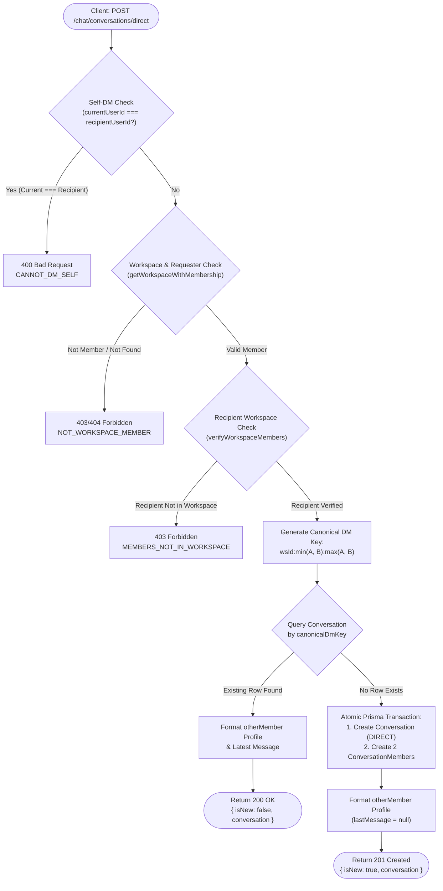
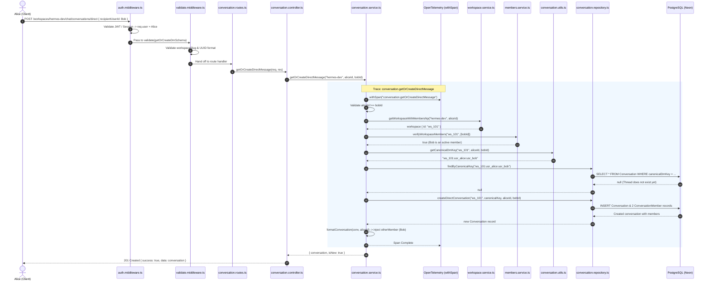
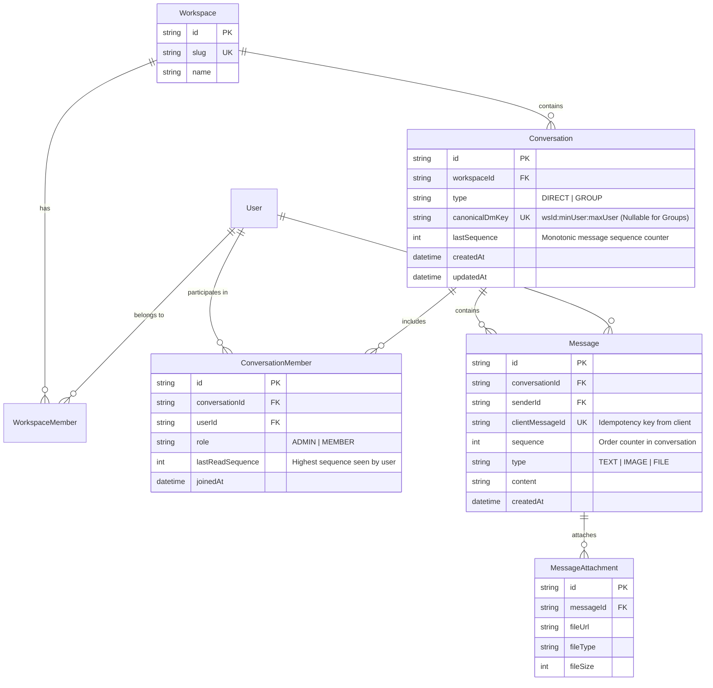
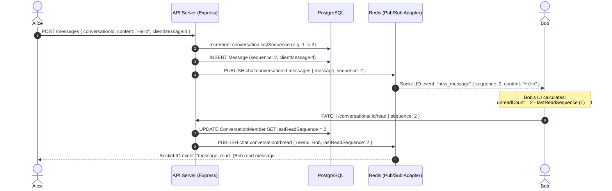

# 👤 Direct Messaging (DM) Implementation & Architecture Guide

**Owner:** Harshit (DM & Core Backend Lead)  
**Status:** Completed & Refactored (Weekend 1)  
**Parent Plan:** [Chat Layer Implementation Plan](./chat-layer-plan.md)  
**Database Schema Reference:** [Unified Chat Database Architecture](../database/unified-chat-schema.md)  
**Source Code Root:** `apps/api/src/modules/chat/conversation/`

---

## 1. High-Level Architecture & Core Concepts

The 1:1 Direct Messaging engine allows any two workspace members to communicate privately without creating duplicate threads. To maintain strict data integrity and prevent race conditions across distributed instances, the design is founded on three core pillars:

1. **Canonical DM Key (Zero-Duplicate Invariant):**
   A deterministic string key derived by lexicographically sorting the two user IDs:
   $$\text{canonicalDmKey} = \text{workspaceId} + ":" + \min(\text{userA}, \text{userB}) + ":" + \max(\text{userA}, \text{userB})$$
   Whether Alice starts a chat with Bob, or Bob starts a chat with Alice simultaneously, both map to the exact same unique constraint in PostgreSQL (`@unique([canonicalDmKey])`).

2. **Monotonic Conversation Sequence (`lastSequence`):**
   Instead of relying on fragile client timestamps, each conversation thread tracks a strictly increasing monotonic integer counter (`lastSequence`). Every message inserted into the conversation increments this sequence atomically.
   $$\text{unreadCount} = \text{conversation.lastSequence} - \text{member.lastReadSequence}$$

3. **Workspace Boundary & Mutual Verification:**
   DMs cannot cross workspace boundaries. Both the requester and the recipient are validated against the workspace membership before any database query or thread creation occurs.

---

## 2. Architecture & Flow Diagrams

### Diagram 1: Canonical DM Resolution Flowchart
This flowchart illustrates the complete decision tree when a client requests or creates a 1:1 direct message thread:



---

### Diagram 2: End-to-End Request/Response Sequence
Detailed interaction across Express middlewares, Zod validation, Service layer, OpenTelemetry tracing, and the Database:



---

### Diagram 3: Entity-Relationship Diagram (DM Data Model)
The relational model connecting Workspaces, Users, Conversations, Members, and Messages:



---

### Diagram 4: Real-Time Messaging & Read Receipt Lifecycle
When Alice sends a message to Bob inside this conversation and Bob marks it as read:



---

## 3. Directory Structure & File Breakdown

The entire 1:1 DM engine resides in `apps/api/src/modules/chat/conversation/`:

```text
apps/api/src/modules/chat/conversation/
├── conversation.utils.ts       # Canonical DM key generation math
├── conversation.schema.ts      # Zod validation schemas for requests
├── conversation.repository.ts  # Prisma queries for Conversation & Member
├── conversation.service.ts     # Business logic, authorization, & OTel withSpan
├── conversation.controller.ts  # Express request/response handlers
└── conversation.routes.ts      # Express route definitions
```

---

### 3.1 `conversation.utils.ts`

#### Function: `getCanonicalDmKey`
- **Signature:** `getCanonicalDmKey(workspaceId: string, userAId: string, userBId: string): string`
- **Purpose:** Sorts the two UUIDs alphabetically and produces a deterministic unique key.
- **Implementation:**
  ```typescript
  export function getCanonicalDmKey(
    workspaceId: string,
    userAId: string,
    userBId: string,
  ): string {
    const [smallerId, greaterId] = [userAId, userBId].sort();
    return `${workspaceId}:${smallerId}:${greaterId}`;
  }
  ```
- **Example:**
  - `userA` = `"usr_zebra"`, `userB` = `"usr_apple"`, `workspaceId` = `"ws_1"`
  - Output: `"ws_1:usr_apple:usr_zebra"`
  - Guarantee: Calling `getCanonicalDmKey("ws_1", "usr_zebra", "usr_apple")` produces the exact same string.

---

### 3.2 `conversation.schema.ts`

Defines strict runtime schemas validated by Zod before reaching controllers:

1. **`getOrCreateDmSchema`:**
   - Validates `params.workspaceSlug` (non-empty string).
   - Validates `body.recipientUserId` (must be a valid UUID).
2. **`listConversationsSchema`:**
   - Validates `params.workspaceSlug`.
   - Validates optional `query.type` (`"DIRECT"` or `"GROUP"`).
3. **`getConversationByIdSchema`:**
   - Validates `params.workspaceSlug`.
   - Validates `params.conversationId` (must be a valid UUID).

---

### 3.3 `conversation.repository.ts`

Encapsulates all direct database access using Prisma Client:

| Method | Parameters | Description |
| :--- | :--- | :--- |
| `findByCanonicalKey` | `canonicalDmKey: string` | Retrieves a conversation by its unique canonical key. Includes members with sanitized user profiles (`id`, `name`, `email`, `imageUrl`) and the latest message snippet (`take: 1, orderBy: { sequence: "desc" }`). |
| `createDirectConversation` | `workspaceId, canonicalDmKey, currentUserId, recipientUserId` | Executes an atomic creation inserting 1 `Conversation` row (`type: DIRECT`) and 2 `ConversationMember` rows (`role: "MEMBER"`). |
| `findUserConversations` | `workspaceId, userId, type?` | Queries all conversations in the workspace where the user is an active member (`members: { some: { userId } }`). Orders by `updatedAt DESC`. |
| `findById` | `conversationId, workspaceId` | Queries a specific conversation row scoped to the given `workspaceId` with members eagerly loaded. |

---

### 3.4 `conversation.service.ts`

Handles core business rules, workspace validation, telemetry spans, and response formatting:

#### Method: `getOrCreateDirectMessage(workspaceSlug, currentUserId, recipientUserId)`
1. **Self-DM Guard:** Checks `currentUserId === recipientUserId`. If so, throws `AppError(400, "CANNOT_DM_SELF")`.
2. **Workspace & Requester Verification:** Calls `getWorkspaceWithMembership(workspaceSlug, currentUserId)` from `apps/api/src/modules/workspace/workspace.service.ts`. Ensures the workspace exists and the caller is an active member.
3. **Recipient Verification:** Calls `verifyWorkspaceMembers(workspace.id, [recipientUserId])` from `apps/api/src/modules/members/members.service.ts`. If the recipient does not belong to the workspace, throws `AppError(403, "MEMBERS_NOT_IN_WORKSPACE")`.
4. **Canonical Key Lookup:** Computes `canonicalDmKey` via `getCanonicalDmKey`.
5. **Idempotent Return / Atomic Create:**
   - If existing conversation is found: returns `{ conversation: format(existing), isNew: false }`.
   - If not found: creates new conversation via repository, returning `{ conversation: format(created), isNew: true }`.
6. **Telemetry:** Entire operation wrapped in `withSpan("conversation.getOrCreateDirectMessage", ...)`.

#### Method: `listUserConversations(workspaceSlug, currentUserId, type?)`
- Verifies workspace membership.
- Fetches all user threads in the workspace.
- Transforms each conversation so that `otherMember` profile is hoisted to top level for 1:1 DMs.
- Wrapped in `withSpan("conversation.listUserConversations", ...)`.

#### Method: `getConversationById(workspaceSlug, currentUserId, conversationId)`
- Verifies workspace membership.
- Retrieves conversation from repository.
- Checks `conversation.members.some(m => m.userId === currentUserId)`. If false, throws `AppError(403, "NOT_CONVERSATION_MEMBER")`.
- Wrapped in `withSpan("conversation.getConversationById", ...)`.

#### Helper: `formatConversation(conversation, currentUserId)`
Flattens the relational Prisma payload for the frontend:
- Dynamically finds the other participant: `conversation.members.find(m => m.userId !== currentUserId)?.user`.
- Extracts `otherMember`: `{ id, name, email, imageUrl }`.
- Extracts `lastMessage`: latest message snippet or `null`.

---

### 3.5 `conversation.controller.ts`

Express controllers mapping HTTP requests to service calls:

- **`getOrCreateDirectMessage`**:
  - Extracts `req.user.id` from the authenticated JWT session.
  - Returns `201 Created` when `isNew === true`.
  - Returns `200 OK` when `isNew === false`.
- **`listConversations`**:
  - Extracts `req.query.type` (`DIRECT` or `GROUP`).
  - Returns `200 OK` with array of conversations.
- **`getConversationById`**:
  - Extracts `req.params.conversationId`.
  - Returns `200 OK` with conversation details.

---

### 3.6 `conversation.routes.ts`

Mounted in the workspace router at `/:workspaceSlug/chat/conversations` using `Router({ mergeParams: true })`:

```typescript
const router = Router({ mergeParams: true });

router.post("/direct", validate(getOrCreateDmSchema), asyncHandler(conversationController.getOrCreateDirectMessage));
router.get("/", validate(listConversationsSchema), asyncHandler(conversationController.listConversations));
router.get("/:conversationId", validate(getConversationByIdSchema), asyncHandler(conversationController.getConversationById));
```

---

## 4. API Endpoints Reference

All endpoints require authentication (`Authorization: Bearer <token>` or session cookie).

### 4.1 Create or Fetch 1:1 Direct Message
* **Path:** `POST /api/v1/workspaces/:workspaceSlug/chat/conversations/direct`
* **Request Headers:**
  ```http
  Authorization: Bearer <jwt_access_token>
  Content-Type: application/json
  ```
* **Request Body:**
  ```json
  {
    "recipientUserId": "b4a8e291-7681-4209-9fc4-9351e39a3821"
  }
  ```
* **Response Statuses:**
  - `201 Created` — First time Alice and Bob initiate a chat.
  - `200 OK` — Chat already exists between Alice and Bob.
* **Success Response Body:**
  ```json
  {
    "success": true,
    "data": {
      "id": "c1f73b09-0824-42f2-89b5-927161b96d92",
      "workspaceId": "d3b07384-d113-4f0e-b7df-9856a9e1e231",
      "type": "DIRECT",
      "title": null,
      "description": null,
      "iconUrl": null,
      "canonicalDmKey": "d3b07384:a1b2c3d4:b4a8e291",
      "lastSequence": 0,
      "createdAt": "2026-11-10T04:15:00.000Z",
      "updatedAt": "2026-11-10T04:15:00.000Z",
      "members": [
        {
          "id": "m_1",
          "userId": "a1b2c3d4-0000-0000-0000-000000000001",
          "role": "MEMBER",
          "lastReadSequence": 0,
          "user": {
            "id": "a1b2c3d4-0000-0000-0000-000000000001",
            "name": "Alice Johnson",
            "email": "alice@example.com",
            "imageUrl": "https://lh3.googleusercontent.com/..."
          }
        },
        {
          "id": "m_2",
          "userId": "b4a8e291-7681-4209-9fc4-9351e39a3821",
          "role": "MEMBER",
          "lastReadSequence": 0,
          "user": {
            "id": "b4a8e291-7681-4209-9fc4-9351e39a3821",
            "name": "Bob Smith",
            "email": "bob@example.com",
            "imageUrl": null
          }
        }
      ],
      "otherMember": {
        "id": "b4a8e291-7681-4209-9fc4-9351e39a3821",
        "name": "Bob Smith",
        "email": "bob@example.com",
        "imageUrl": null
      },
      "lastMessage": null
    },
    "error": null
  }
  ```

---

### 4.2 List Conversations for Sidebar / Inbox
* **Path:** `GET /api/v1/workspaces/:workspaceSlug/chat/conversations`
* **Query Parameters:**
  - `type` (optional): Filter by conversation type (`DIRECT` or `GROUP`).
* **Example:** `GET /api/v1/workspaces/hermes-dev/chat/conversations?type=DIRECT`
* **Success Response (`200 OK`):**
  ```json
  {
    "success": true,
    "data": [
      {
        "id": "c1f73b09-0824-42f2-89b5-927161b96d92",
        "workspaceId": "d3b07384-d113-4f0e-b7df-9856a9e1e231",
        "type": "DIRECT",
        "canonicalDmKey": "d3b07384:a1b2c3d4:b4a8e291",
        "lastSequence": 42,
        "otherMember": {
          "id": "b4a8e291-7681-4209-9fc4-9351e39a3821",
          "name": "Bob Smith",
          "email": "bob@example.com",
          "imageUrl": null
        },
        "lastMessage": {
          "id": "msg_982",
          "content": "Hey Harshit, PR is ready for review!",
          "sequence": 42,
          "createdAt": "2026-11-10T04:20:00.000Z",
          "senderId": "b4a8e291-7681-4209-9fc4-9351e39a3821",
          "type": "TEXT"
        }
      }
    ],
    "error": null
  }
  ```

---

### 4.3 Fetch Conversation by ID
* **Path:** `GET /api/v1/workspaces/:workspaceSlug/chat/conversations/:conversationId`
* **Security:** Requester must be a member of the conversation.
* **Success Response (`200 OK`):** Returns the full conversation object with member details and latest message.

---

### 4.4 Error Status Codes & Handlers

| HTTP Status | Error Code | Root Cause |
| :--- | :--- | :--- |
| `400 Bad Request` | `CANNOT_DM_SELF` | `recipientUserId` matches the authenticated `currentUserId`. |
| `400 Bad Request` | `VALIDATION_ERROR` | `recipientUserId` is not a valid UUID format, or `workspaceSlug` is missing. |
| `403 Forbidden` | `NOT_WORKSPACE_MEMBER` | Authenticated user is not an active member of the specified workspace. |
| `403 Forbidden` | `MEMBERS_NOT_IN_WORKSPACE` | The recipient user is not a member of this workspace. |
| `403 Forbidden` | `NOT_CONVERSATION_MEMBER` | Attempting to fetch a conversation by ID that the user is not part of. |
| `404 Not Found` | `WORKSPACE_NOT_FOUND` | No workspace matching `:workspaceSlug` exists. |
| `404 Not Found` | `CONVERSATION_NOT_FOUND` | No conversation matching `:conversationId` exists in this workspace. |

---

## 5. Tracing & OpenTelemetry Integration

All service methods are wrapped with `withSpan(...)` from `apps/api/src/observability/telemetry.ts`:

```typescript
return withSpan("conversation.getOrCreateDirectMessage", async () => {
  // Logic executes inside child span...
});
```

### Trace Span Hierarchy in SigNoz:
```text
HTTP POST /api/v1/workspaces/:slug/chat/conversations/direct (Express Span)
└── conversation.getOrCreateDirectMessage (Custom Business Span)
    ├── workspace.getWorkspaceWithMembership (Service Span)
    │   └── prisma.workspace.findUnique (DB Span)
    ├── members.verifyWorkspaceMembers (Service Span)
    │   └── prisma.workspaceMember.count (DB Span)
    ├── prisma.conversation.findUnique (DB Span - Canonical Key)
    └── prisma.conversation.create (DB Span - Atomic Transaction)
```
- **Error Propagation:** If an `AppError` is thrown, `withSpan` automatically records the exception on the span and sets span status to `ERROR` with the message.
- **Latency Optimization:** Canonical DM key lookups execute in `< 3ms` thanks to the PostgreSQL unique index.

---

## 6. Frontend Integration Guidelines (`apps/web`)

### 1. Initiating a DM from a User Profile / Member List:
```typescript
import { api } from "@/lib/api-client";

export async function openDirectMessage(workspaceSlug: string, recipientUserId: string) {
  const response = await api.post(
    `/workspaces/${workspaceSlug}/chat/conversations/direct`,
    { recipientUserId }
  );
  
  const conversation = response.data.data;
  // Navigate to conversation thread
  router.push(`/workspaces/${workspaceSlug}/chat/${conversation.id}`);
}
```

### 2. Computing the Unread Badge:
```typescript
export function getUnreadCount(conversation: Conversation, currentUserId: string): number {
  const currentMember = conversation.members.find(m => m.userId === currentUserId);
  if (!currentMember) return 0;
  
  const diff = conversation.lastSequence - currentMember.lastReadSequence;
  return Math.max(0, diff);
}
```

### 3. Rendering Sidebar List:
```tsx
export function DmSidebarItem({ conversation }: { conversation: FormattedConversation }) {
  const { otherMember, lastMessage } = conversation;

  return (
    <div className="flex items-center gap-3 p-2 hover:bg-muted/50 rounded-lg cursor-pointer">
      <Avatar src={otherMember?.imageUrl} fallback={otherMember?.name?.[0]} />
      <div className="flex-1 min-w-0">
        <p className="font-medium text-sm truncate">{otherMember?.name}</p>
        <p className="text-xs text-muted-foreground truncate">
          {lastMessage?.content || "No messages yet"}
        </p>
      </div>
    </div>
  );
}
```
