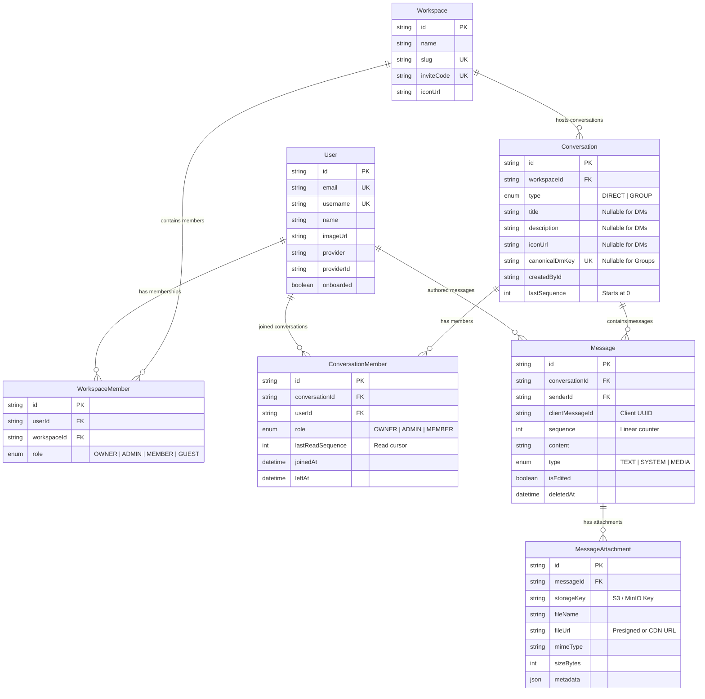
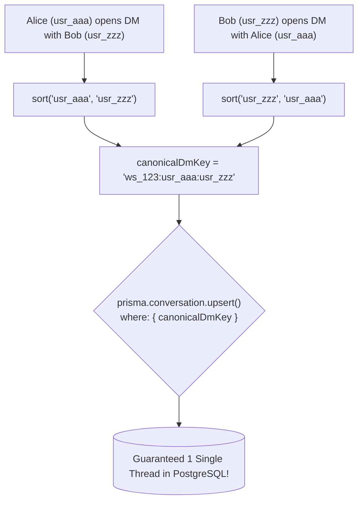
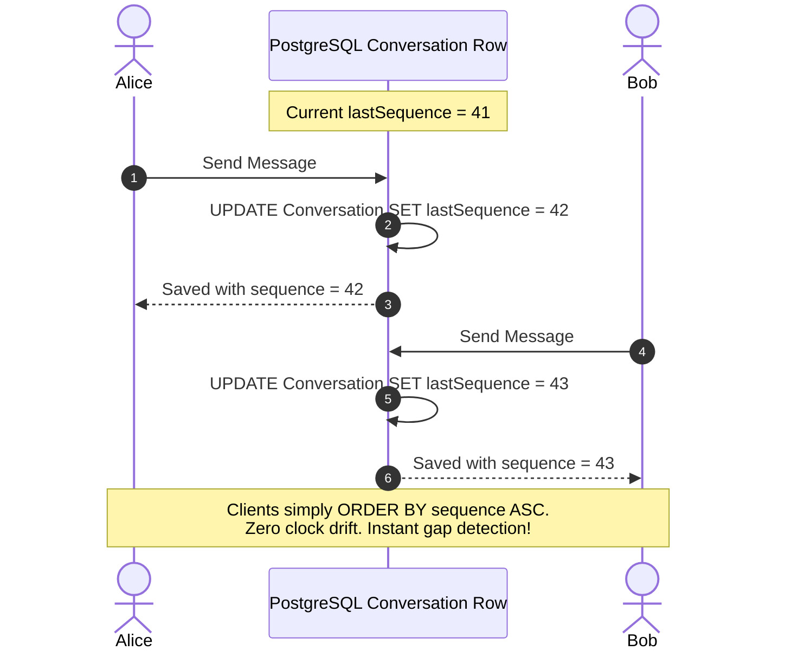
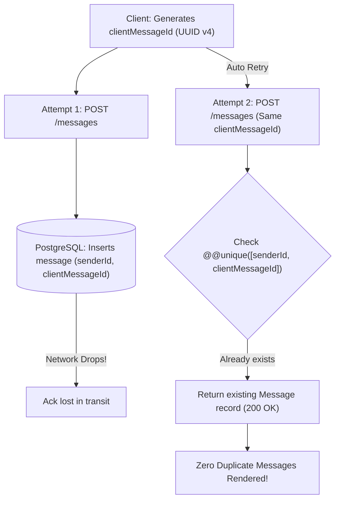

# 🗄️ Unified Chat Database Architecture

This document describes the **Unified Chat Data Model** implemented in `apps/api/prisma/schema.prisma`, explaining the schema design, mathematical deduplication keys, monotonic sequencing, and idempotency guarantees.

---

## 1. Complete Entity-Relationship (ER) Diagram

---

## 2. Core Architectural Principles

### A. The Unified Abstraction (No Separate DM/Channel Tables)
* **The Problem:** Many chat applications build two independent stacks: `DirectMessage` + `DMConversation` versus `ChannelMessage` + `Channel`. This doubles your API controllers, services, database queries, and socket event pipelines.
* **The Hermes Solution:** A single polymorphic **`Conversation`** model.
  * **Direct Messages (1:1):** `type = DIRECT`, exactly 2 members, and a composite `canonicalDmKey`.
  * **Group Channels (1:N):** `type = GROUP`, 1 to $N$ members, custom `title`, and role-based permissions (`OWNER`, `ADMIN`, `MEMBER`).

---

### B. Mathematical 1:1 DM Deduplication (`canonicalDmKey`)

When two users open a chat simultaneously, race conditions can produce duplicate conversation threads between the same two people in a workspace.

#### The Algorithm:
To guarantee that Alice opening a DM with Bob yields the exact same conversation row as Bob opening a DM with Alice, we compute a sorted canonical composite string:

$$\text{canonicalDmKey} = \text{workspaceId} + ":" + \min(\text{userA}, \text{userB}) + ":" + \max(\text{userA}, \text{userB})$$

> [!IMPORTANT]
> Because `canonicalDmKey` carries a `@unique` constraint at the database layer, PostgreSQL rejects any concurrent duplicate insertions, guaranteeing strict 1:1 DM uniqueness. For Group chats, `canonicalDmKey` is `NULL`.

---

### C. Deterministic Ordering via Monotonic Server Sequences

Relying on client clocks or microsecond timestamps (`createdAt`) causes severe message jumping due to clock drift (e.g., Client A's phone is 3 seconds ahead of Client B's laptop).

* **Linear Sequencing:** Each conversation maintains an integer `lastSequence`. Every new message atomically increments this sequence.
* **Gap Detection:** If a client receives sequence `42` followed by sequence `45`, the client instantly knows it missed sequences `43` and `44` and triggers a reconnection sync: `GET /messages?afterSequence=42`.
* **Database Constraint:** `@@unique([conversationId, sequence])`.

---

### D. Idempotent Message Persistence (`clientMessageId`)

Under unstable cellular connections, a client may send a message, have it saved to the database, but lose internet connectivity before receiving the HTTP `201 Created` acknowledgment. When the client retries, a duplicate message would typically be inserted.

---

## 3. Database Indexes & Performance Strategy

| Target Model | Index Definition | Purpose |
| :--- | :--- | :--- |
| `Conversation` | `@@index([workspaceId, type])` | Speeds up filtering DMs vs Groups inside a workspace sidebar. |
| `ConversationMember` | `@@unique([conversationId, userId])` | Prevents a user from joining the same conversation twice. |
| `ConversationMember` | `@@index([userId, conversationId, lastReadSequence])` | Optimizes real-time unread badge calculation across thousands of threads. |
| `Message` | `@@unique([conversationId, sequence])` | Enforces linear sequence allocation without duplicate sequence numbers. |
| `Message` | `@@unique([senderId, clientMessageId])` | Enforces message send idempotency. |
| `Message` | `@@index([conversationId, sequence(sort: Desc)])` | Powers fast cursor pagination when scrolling chat history. |

