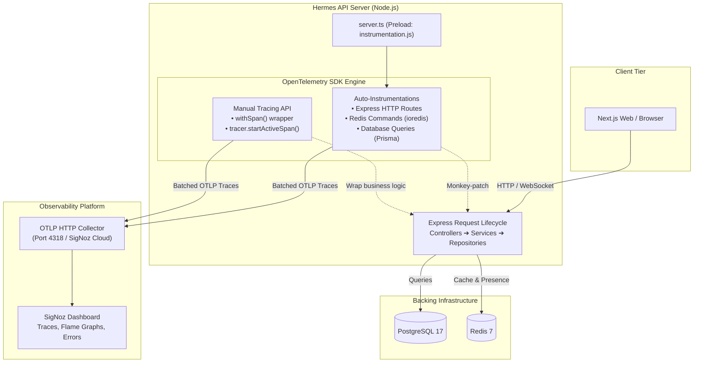
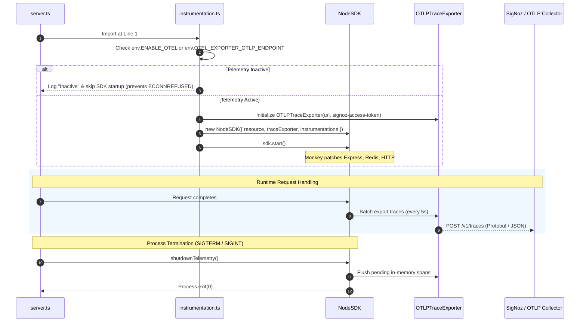
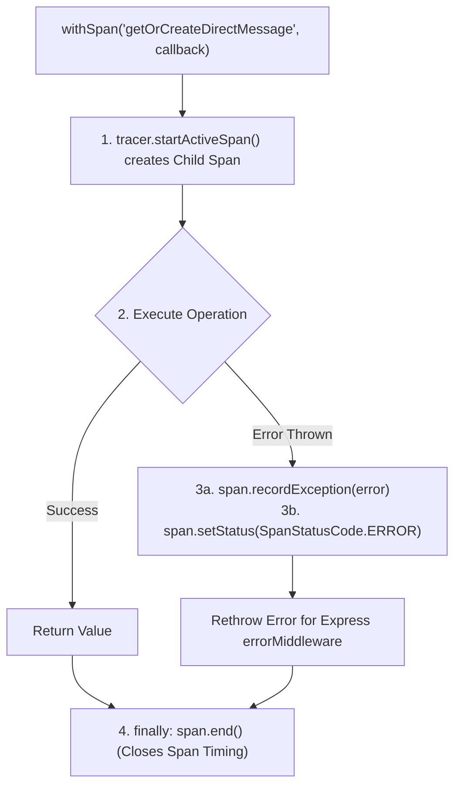

# 📡 Observability Documentation

Welcome to the **Hermes Observability & Telemetry** documentation.

This folder covers the end-to-end distributed tracing, metrics, and error monitoring architecture implemented in Hermes (`apps/api`) using **OpenTelemetry (OTel)** and **SigNoz**.

---

## 📑 Contents

1. [Overview & Architecture Pipeline](#1-overview--architectural-philosophy)
2. [Directory Structure & Component Responsibilities](#2-directory-structure--file-responsibilities)
3. [How OpenTelemetry Works Under the Hood](#3-how-it-works-under-the-hood)
   - [The Boot Order Rule (`server.ts`)](#a-the-boot-order-rule-serverts)
   - [The SDK Bootstrapper (`instrumentation.ts`)](#b-the-sdk-bootstrapper-instrumentationts)
   - [Custom Tracing & Error Capture (`telemetry.ts`)](#c-custom-tracing--error-capture-telemetryts)
4. [Configuration & Environment Variables](#4-configuration-reference)
5. [How to View Traces (Local Docker vs SigNoz Cloud)](#5-how-to-test--view-traces)

---

## 1. Overview & Architectural Philosophy

Hermes uses industry-standard, vendor-neutral **OpenTelemetry** for end-to-end distributed tracing. By relying on native OTel SDKs rather than proprietary agent binaries, telemetry data can be dispatched to **SigNoz**, Jaeger, Datadog, or Grafana Tempo without changing a single line of business code.



---

## 2. Directory Structure & File Responsibilities

The observability layer is encapsulated within [`apps/api/src/observability/`](file:///d:/WEB%20DEV%20udemy/FULLSTACK_PROJECTS/Hermes-repo/Hermes/apps/api/src/observability/):

```text
apps/api/src/observability/
├── index.ts              # Public API barrel (exports tracer, withSpan, shutdownTelemetry)
├── instrumentation.ts    # SDK initialization, OTLP exporter, auto-instrumentations
└── telemetry.ts          # Custom tracing tracer and error-recording withSpan wrapper
```

| File | Purpose |
| :--- | :--- |
| **`instrumentation.ts`** | Initializes the `NodeSDK`, binds the `OTLPTraceExporter`, configures auto-instrumentation, and provides graceful shutdown. |
| **`telemetry.ts`** | Houses the custom tracer instance and the `withSpan` wrapper for manual application-level tracing. |
| **`index.ts`** | Clean barrel export providing a unified API for the rest of the application. |

---

## 3. How It Works Under the Hood

### A. The Boot Order Rule (`server.ts`)

In Node.js, auto-instrumentation relies on **monkey-patching** core modules (`http`, `net`) and third-party libraries (`express`, `ioredis`, `@prisma/client`). 

> [!IMPORTANT]
> The OpenTelemetry SDK must initialize **before** any application modules are imported. If `express` or `http` are imported before `instrumentation.js`, they load with unpatched prototypes, and auto-tracing will fail silently.

```typescript
// apps/api/src/server.ts (Line 1 MUST be the instrumentation import)
import "./observability/instrumentation.js";
import app from "./app";
import http from "http";
...
```

---

### B. The SDK Bootstrapper (`instrumentation.ts`)

Configures the `NodeSDK` with auto-instrumentations, resource attributes, and dev safeguards:



#### Key Technical Decisions in `instrumentation.ts`:
1. **Disabled `fs` Tracing:** File-system reads (`@opentelemetry/instrumentation-fs`) are disabled to eliminate noisy file-load spans on startup.
2. **Safe Development Guard (`isEnabled`):** If SigNoz is not running, the SDK does not boot, completely preventing `ECONNREFUSED` unhandled error logs in your local console.
3. **SigNoz Cloud Token Authentication:** Injects `signoz-access-token` header when `SIGNOZ_INGESTION_KEY` is present.

---

### C. Custom Tracing & Error Capture (`telemetry.ts`)

While auto-instrumentation captures HTTP and database calls, `withSpan` allows developers to trace complex internal business logic and domain boundaries.



#### Usage Example:
```typescript
import { withSpan } from "../observability/index.js";

export async function getOrCreateDirectMessage(workspaceId: string, userAId: string, userBId: string) {
  return withSpan("conversation.getOrCreateDirectMessage", async () => {
    // Both database calls and calculations inside this function
    // are automatically recorded and linked under this active span!
    const key = getCanonicalDmKey(workspaceId, userAId, userBId);
    return conversationRepository.findOrCreate(key);
  });
}
```

---

## 4. Configuration Reference

All observability options are declared in [`apps/api/src/config/env.ts`](file:///d:/WEB%20DEV%20udemy/FULLSTACK_PROJECTS/Hermes-repo/Hermes/apps/api/src/config/env.ts) and configured via `.env`:

| Environment Variable | Type | Default | Description |
| :--- | :--- | :--- | :--- |
| `ENABLE_OTEL` | `boolean` | `false` | Explicit toggle to start or stop telemetry. |
| `OTEL_SERVICE_NAME` | `string` | `"hermes-api"` | Service identifier displayed in SigNoz / Jaeger UI. |
| `OTEL_EXPORTER_OTLP_ENDPOINT` | `string` | `"http://localhost:4318"` | Target OTLP collector endpoint. |
| `SIGNOZ_INGESTION_KEY` | `string` | `""` | Access token required when exporting to **SigNoz Cloud**. |

---

## 5. How to Test & View Traces

### Option A: Using SigNoz Cloud (Recommended — 0 Local RAM Impact)
1. Sign up for free at [signoz.io](https://signoz.io).
2. Set `.env`:
   ```env
   ENABLE_OTEL=true
   OTEL_EXPORTER_OTLP_ENDPOINT=https://ingest.{region}.signoz.cloud:443/v1/traces
   SIGNOZ_INGESTION_KEY=your_ingestion_key_here
   ```
3. Run `pnpm dev`.
4. Trigger any API endpoint (e.g. `POST /api/v1/presence`), and inspect the real-time flame graph in your SigNoz browser console.

### Option B: Local SigNoz via Docker
Run the standalone OTel collector / SigNoz container on port `4318` and set:
```env
ENABLE_OTEL=true
OTEL_EXPORTER_OTLP_ENDPOINT=http://localhost:4318
```

